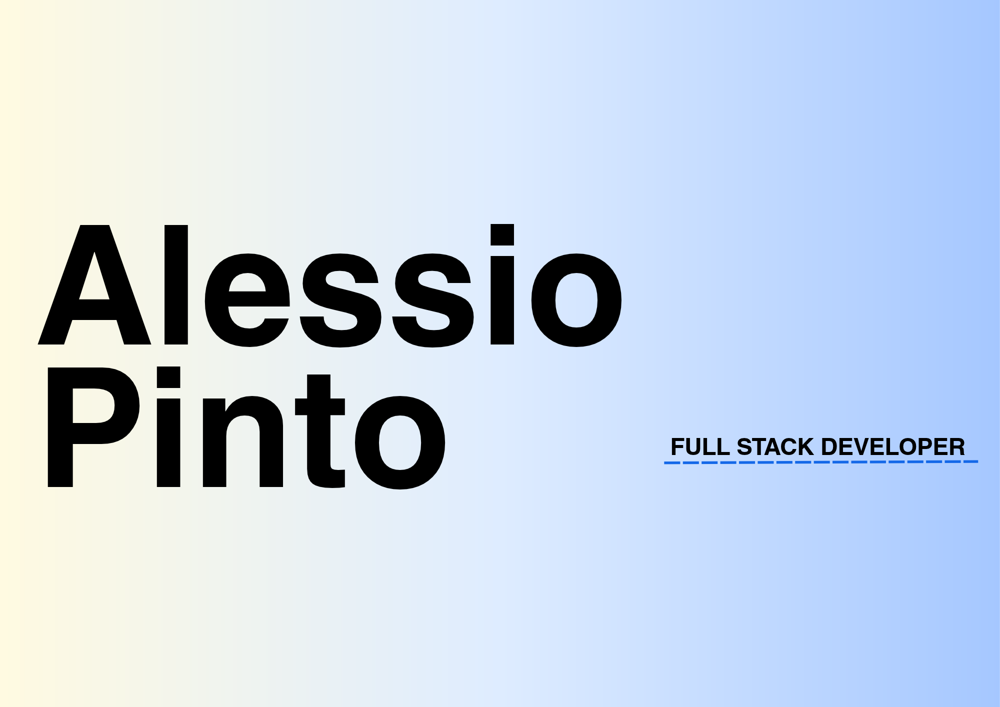

 

<table width="100%">
  <tr>
    <td align="left">
      AP® — DIGITAL PORTFOLIO
    </td>
    <td align="right">
      GENOVA, ITALY / 2026
    </td>
  </tr>
</table>

 

<h2>01 / Tech Stack</h2>

  
  
  
  
  
  
  
  
  

 

<h2>02 / Currently</h2>

<table width="100%">
  <tr>
    <td width="50%" valign="top">
      01 — WORK
      <h3>Full Stack Developer</h3>
      

        Developing and maintaining web solutions
        at <strong>twow</strong>.
      

    </td>
    <td width="50%" valign="top">
      02 — LEARNING
      <h3>ASP.NET Core</h3>
      

        Exploring backend development,
        C# and Entity Framework Core.
      

    </td>
  </tr>
  <tr>
    <td valign="top">
      03 — BUILDING
      <h3>Booking Management System</h3>
      

        A REST API built with ASP.NET Core
        and Entity Framework Core.
      

    </td>
    <td valign="top">
      04 — PORTFOLIO
      <h3>Selected Work ↗</h3>
      

        <a href="https://alessiopinto.com">
          alessiopinto.com
        </a>
      

    </td>
  </tr>
</table>

 

<h2>03 / About</h2>

  Full Stack Developer based in Genoa, Italy.
  I build and maintain web applications,
  with a focus on clean code, performance
  and continuous learning.

 

<h2>04 / Connect</h2>

  <a href="https://alessiopinto.com">PORTFOLIO ↗</a>
  &nbsp;&nbsp; / &nbsp;&nbsp;
  <a href="https://www.linkedin.com/in/alessio-pinto/">LINKEDIN ↗</a>

<table width="100%">
  <tr>
    <td align="left">
      ALESSIO PINTO © 2026
    </td>
    <td align="right">
      DESIGN × DEVELOPMENT
    </td>
  </tr>
</table>
